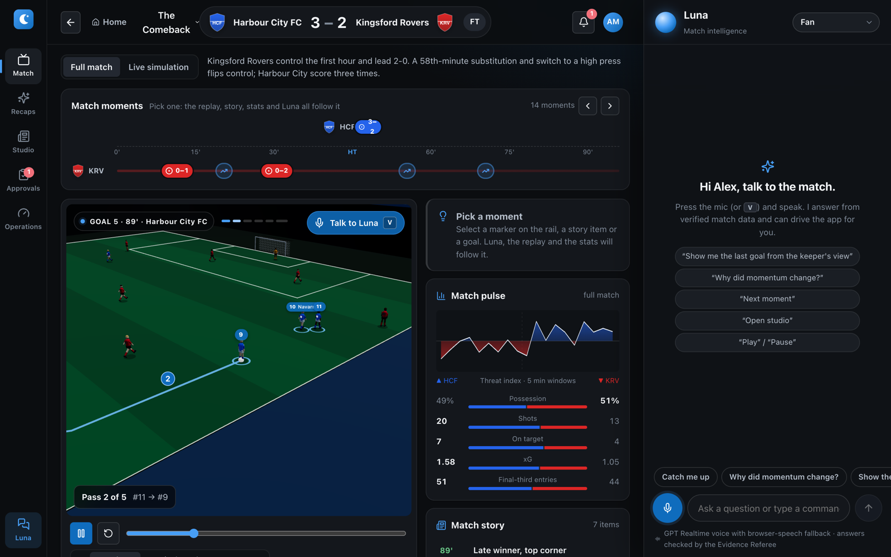
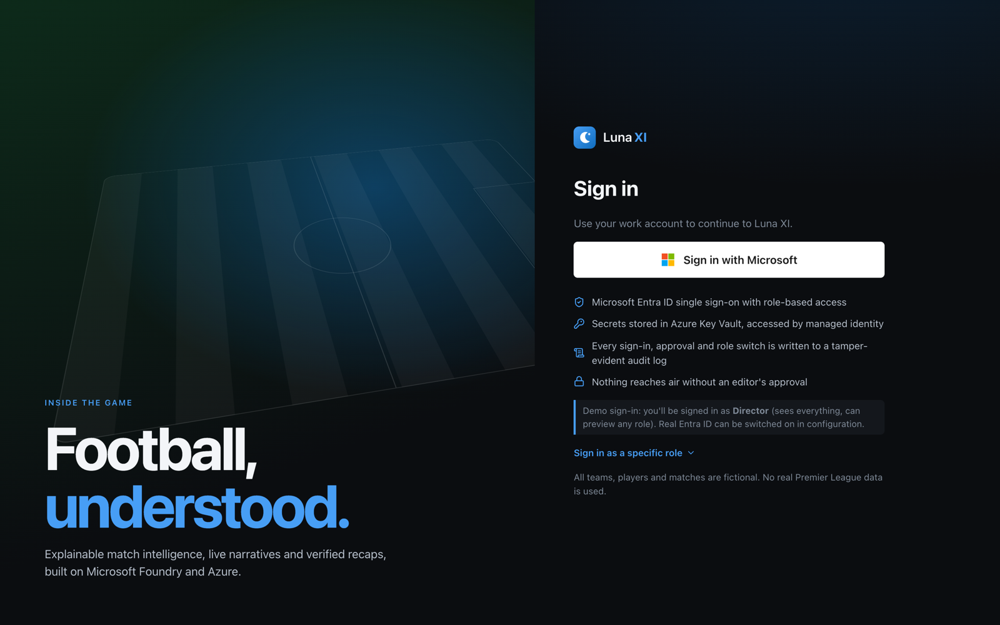
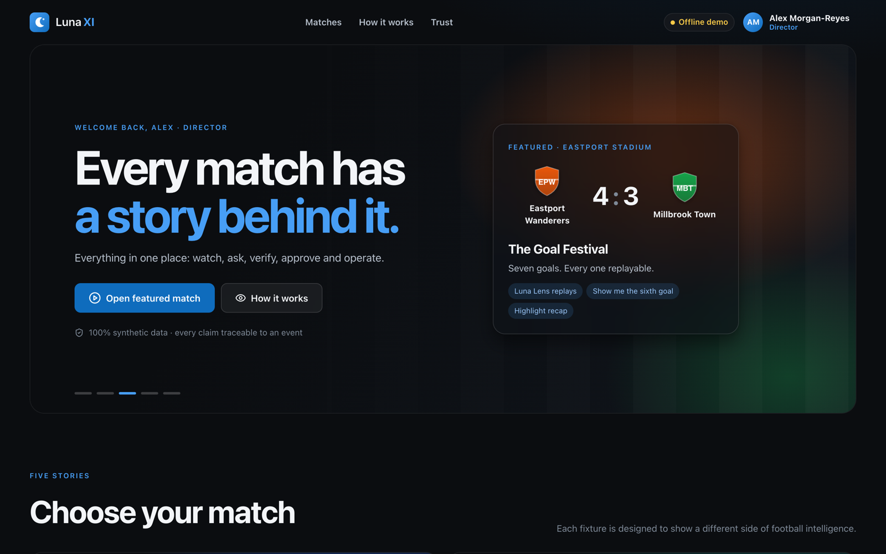
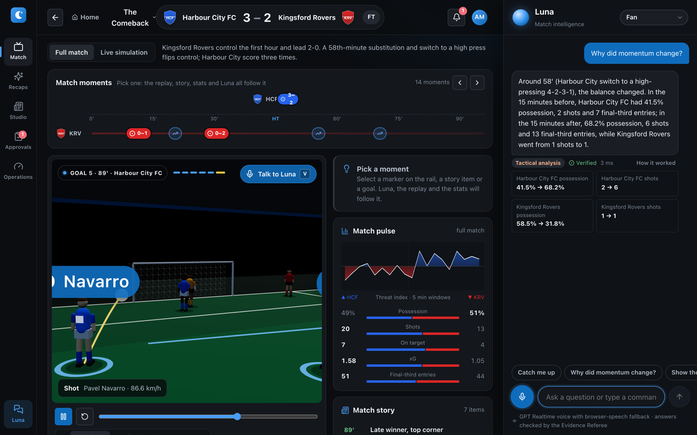
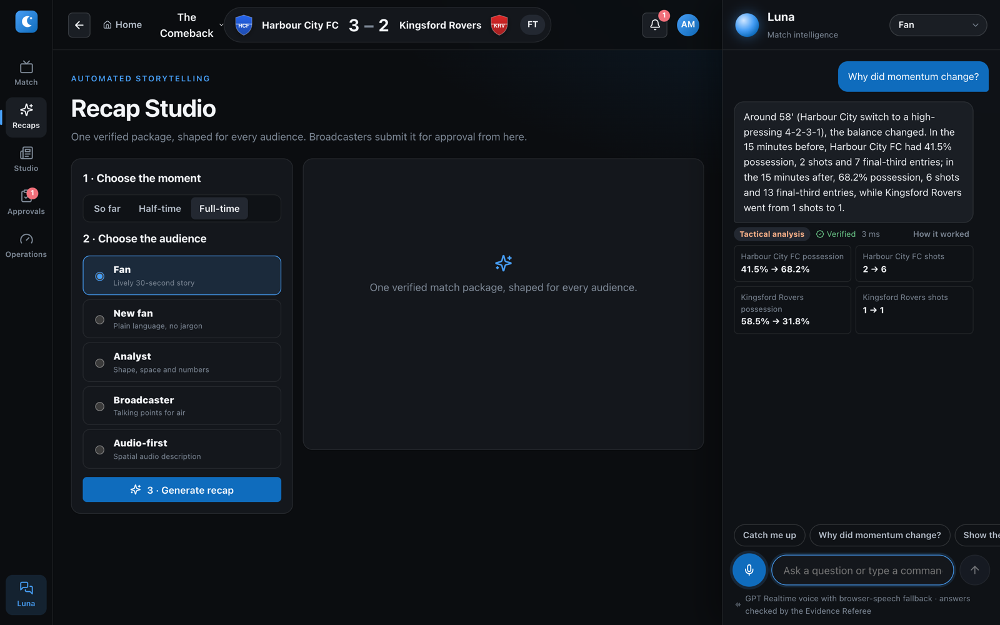
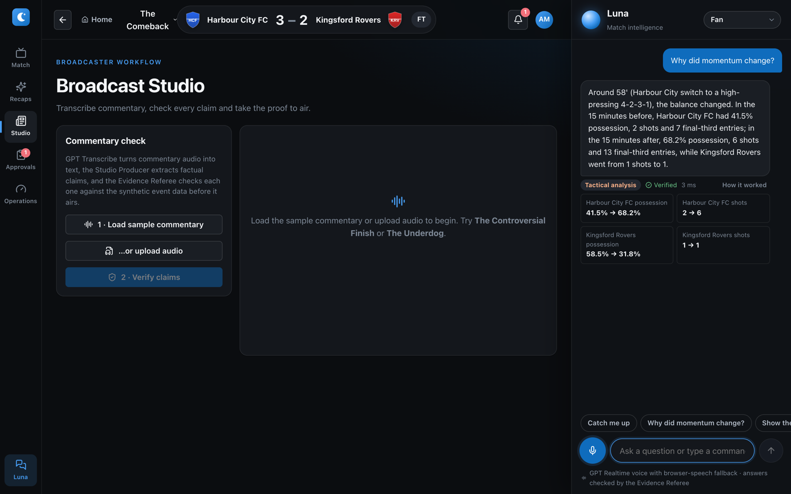
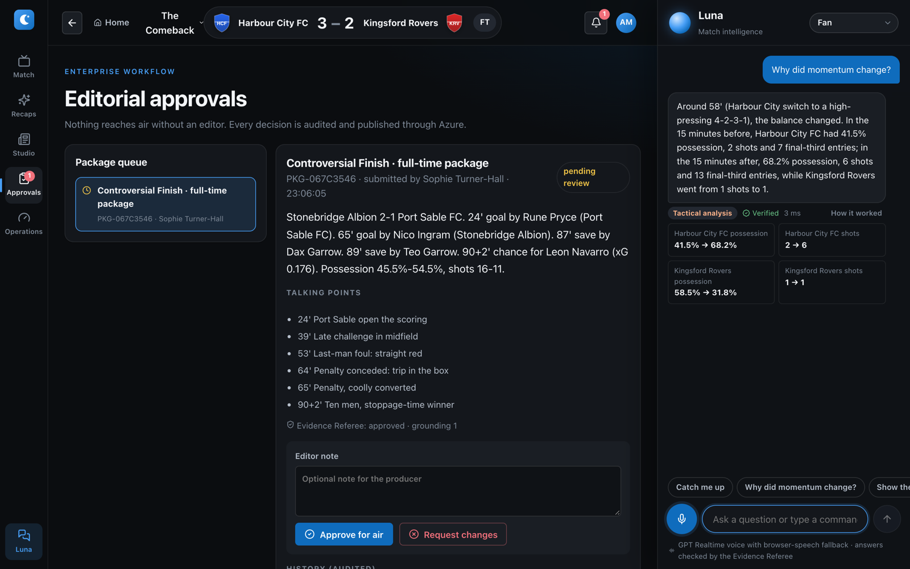
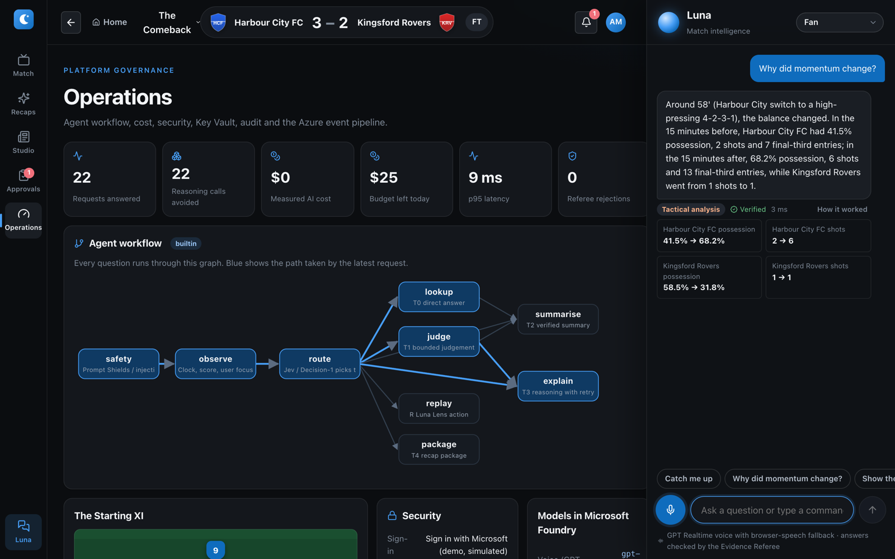
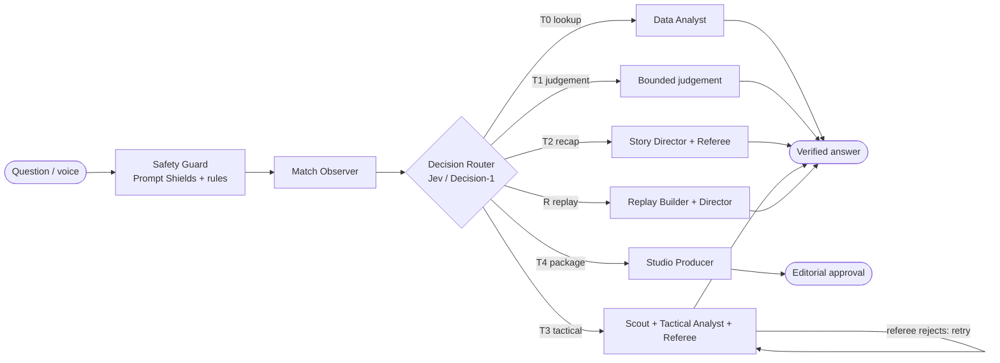
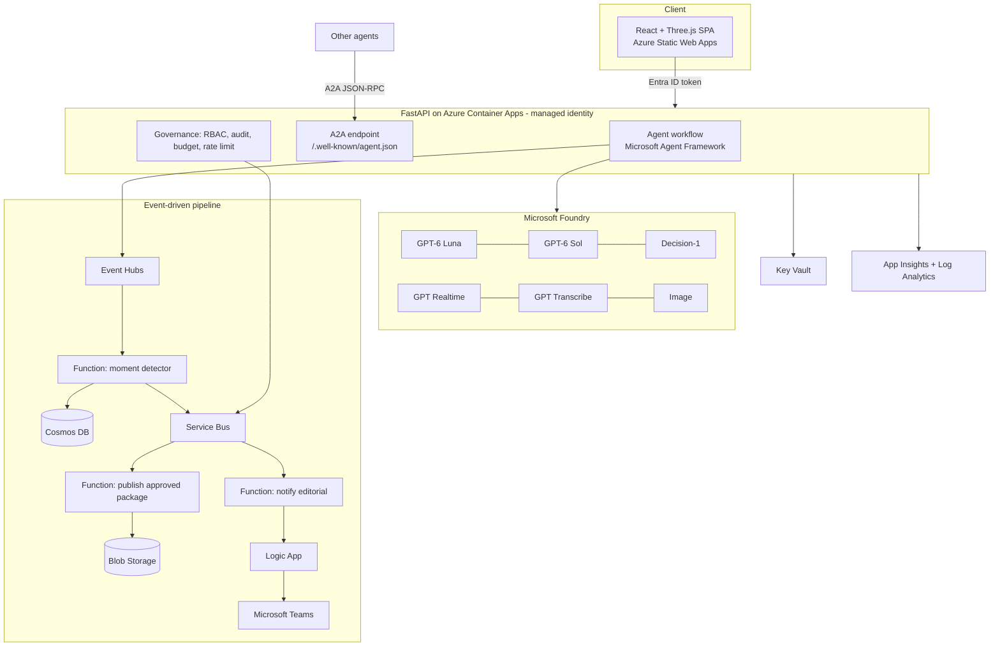

<div align="center">

# 🌙 Luna XI

### Football, understood.
**Talk to the match. See the evidence. Put only verified stories on air.**




*Every team, player and match is fictional. No real Premier League data is used.*

</div>

---

## What is Luna XI?

Football produces thousands of events per match: passes, shots, pressures, substitutions. Fans can't follow them all, analysts spend hours digging, and broadcasters have to trust claims they can't check quickly.

**Luna XI turns synthetic football events into explainable match intelligence.** Ask a question by voice or text and get an answer that is:

- **Grounded.** Every number comes from the event data, computed deterministically. The language model only writes the words.
- **Verified.** An *Evidence Referee* agent rejects any claim not backed by the facts before it reaches you.
- **Explained.** One click shows the full agent trace: which agents ran, what they saw and why.
- **Personal.** The same moment is told differently for a fan, a newcomer, a tactics analyst, a broadcaster or a blind/low-vision listener.
- **Controlled.** Nothing goes on air without an editor's approval, every action is audited, and every role sees only what it should.

> **One idea behind the whole project:** AI should *write about* football, never *invent* football. Facts are computed. Language is generated. The referee checks one against the other.

---

## See it working

| | |
|---|---|
| **Sign in with Microsoft** (Entra ID in production, simulated in demo mode). Six roles: Fan, Analyst, Broadcaster, Editor, Admin, Director. | **Home.** Five fictional matches, each built to showcase a different capability. |
|  |  |
| **Match workspace.** Moment rail, 3D *Luna Lens* replay, live threat index and stats, all following the moment you pick. | **Ask Luna.** *"Why did momentum change?"* returns a verified answer with before/after evidence and a *How it worked* trace. |
|  |  |
| **Recap Studio.** One verified package shaped for every audience. | **Broadcast Studio.** Transcribe commentary and check every claim before air. |
|  |  |
| **Editorial approvals.** Human-in-the-loop sign-off, audited and published through Azure. | **Operations.** The live agent graph, cost, latency, security posture and audit trail. |
|  |  |

---

## Run it (5 minutes)

Needs **Python 3.10+** (3.12 recommended) and **Node 20+**. It works fully offline. Foundry keys only switch on live models and voice.

```bash
cp .env.example .env                 # works offline; add Foundry keys for live AI + Realtime voice
python3.12 -m venv backend/.venv && source backend/.venv/bin/activate
make setup                           # Python + npm packages
make agents                          # optional: Microsoft Agent Framework (auto-fallback if skipped)
make api                             # terminal 1 -> http://localhost:8000/docs
make web                             # terminal 2 -> http://localhost:5173
```

Click **Sign in with Microsoft** and you are the **Director**: you see everything, and *View as* in the avatar menu previews any other role.
Prefer containers? `docker compose up --build` serves the app on <http://localhost:8080>.

### Try these
- *"Show me the last goal from the keeper's view"* (voice or text; opens the 3D replay)
- *"Why did momentum change?"* (tactical reasoning with before/after evidence)
- *"Catch me up"* (spoiler-safe summary up to the current playback time)
- *"Explain it simply"* (switches the audience to a newcomer)
- *"Open studio"*, *"next moment"*, *"play"*, *"pause"*, *"speed 600"* (voice drives the app)

### Voice
Press the mic or **V**. With Foundry keys Luna uses **GPT Realtime** over WebRTC and can both answer *and* drive the app. Without keys, voice still works in Edge/Chrome via browser speech recognition.

---

## How it works

### The Starting XI: eleven agents, one blackboard

Each agent has a single responsibility. They coordinate through a shared state (`SharedState`) and every step is recorded in a trace.

| # | Agent | Job | Powered by |
|--:|---|---|---|
| 1 | **Match Observer** | Match state at the playback clock; applies the user's focused moment | deterministic |
| 2 | **Data Analyst** | Verified stats; answers simple lookups instantly | deterministic |
| 3 | **Moment Scout** | Finds momentum shifts and turning points | deterministic |
| 4 | **Decision Router** | The *AI Efficiency Gateway*: picks the cheapest tier that can answer | Microsoft-Decision-1 |
| 5 | **Tactical Analyst** | Explains *why*, with before/after evidence | reasoning model (GPT-6 Sol) |
| 6 | **Replay Builder** | Loads and validates replay keyframes (spoiler-safe) | deterministic |
| 7 | **Replay Director** | Camera path and overlays for Luna Lens | deterministic |
| 8 | **Evidence Referee** | Rejects unsupported numbers; the publication gate | rules + decision model |
| 9 | **Story Director** | Audience-specific narratives | fast model (GPT-6 Luna) |
| 10 | **Voice Director** | Realtime voice and transcription | GPT Realtime + GPT Transcribe |
| 11 | **Studio Producer** | Recap packages, posters, commentary checks | fast + image models |

Six Microsoft Foundry models are used, each for what it is best at: fast, reasoning, decision, transcribe, realtime and image.

### The workflow graph



**The AI Efficiency Gateway.** Not every question needs a big model. The router sends *"what's the score?"* to a deterministic lookup (tier T0, about a millisecond, $0) and reserves expensive reasoning (T3) for genuine *why* questions. When confidence is low it escalates a tier. In the Operations screenshot above you can see the saving: **22 requests answered, 22 reasoning calls avoided**.

**Fail-safe by design.** If a model is unavailable the platform falls back to deterministic answers instead of failing. If the Referee rejects a draft, the step retries and ultimately falls back to a verified template.

---

## Architecture



Infrastructure is defined as code in [infra/main.bicep](infra/main.bicep) (deploy with [infra/deploy.sh](infra/deploy.sh)); Entra app roles are set up by [infra/entra-setup.sh](infra/entra-setup.sh).

---

## Hackathon categories: how Luna XI answers each one

### 🏆 Grand Prize: best overall solution with real-world impact

> *"Transform synthetic football event data into meaningful, explainable match intelligence … engaging narratives, contextual insights, and accessible and personalised experiences for fans, analysts, and broadcasters."*

| What the judges ask for | What Luna XI does |
|---|---|
| **Meaningful, explainable intelligence** | Every answer carries its evidence (e.g. *possession 41.5% → 68.2%*) and a *How it worked* trace. Nothing is a black box. |
| **Engaging narratives** | Story Director writes match stories, live narration and recap packages from verified facts. |
| **Contextual insights** | Moment Scout finds turning points; Tactical Analyst explains *why* a substitution or formation change shifted the match. |
| **Accessible** | An *accessible* audience mode describes where on the pitch things happen (left/right, near which goal) for blind and low-vision listeners. Voice-first control. |
| **Personalised** | Five audiences (fan, new fan, tactical, broadcaster, accessible) and six role-based experiences from one source of truth. |
| **For fans, analysts *and* broadcasters** | Fans get *Talk to the match* and 3D replays. Analysts get deep tactical reasoning. Broadcasters get Recap Studio, commentary fact-checking and approval workflows. |
| **Real-world impact** | Misinformation on air is a real broadcast risk. The Referee and the editorial gate turn "AI wrote it" into "AI wrote it, the evidence backs it, an editor approved it." |

Five hand-built showcase matches each demonstrate a different capability: **The Comeback** (momentum shift, substitution impact), **The Tactical Battle**, **Goal Festival**, **The Underdog** (possession is not control) and **The Controversial Finish** (commentary verification and editorial approval).

### 🧠 Best use of Microsoft Foundry

- **Six Foundry models, right-sized.** Fast (GPT-6 Luna), reasoning (GPT-6 Sol), a dedicated decision model (Microsoft-Decision-1), Realtime voice, Transcribe and image generation, all through one client ([backend/app/foundry/](backend/app/foundry/)).
- **Model routing as a feature.** The Decision Router sends each request to the cheapest model that is good enough, with measured results on the Operations page: *reasoning calls avoided, cost, p95 latency*.
- **Voice as a first-class interface.** GPT Realtime over WebRTC with ephemeral client secrets (the browser never sees an API key). Luna answers *and* controls the app through tool commands.
- **Faster to build, cheaper to run.** One typed client, one config surface (`.env`), deployment names configurable per model, and an automatic offline fallback so development never blocks on quota.
- **Safety built in.** Prompt Shields and content-safety screening run as the first node of every workflow.

### 💼 Best enterprise solution

Luna XI is designed around the controls a production deployment needs:

| Concern | Implementation |
|---|---|
| **Identity** | Microsoft Entra ID bearer tokens in production (`AUTH_MODE=entra`), simulated sign-in for demos. |
| **Least privilege (RBAC)** | Six roles mapped to capabilities ([backend/app/security/auth.py](backend/app/security/auth.py)): only Editor/Admin/Director can approve, only Admin/Director can see Operations. |
| **Separation of duties** | A broadcaster can *submit* a package but cannot *approve* it. Tested. |
| **Human in the loop** | Packages move through submit, review and approve before publishing. A Logic App notifies editors in Teams. |
| **Auditability** | Every ask, role switch, submission and decision lands in an audit log. |
| **Cost control** | Daily AI budget (`DAILY_AI_BUDGET_USD`), per-user rate limiting, measured cost per request. |
| **Secrets** | Azure Key Vault with managed identity; no secrets in code. Only `.env.example` is committed. |
| **Transparency** | *How it worked* traces and a provenance endpoint show what ran and which engine/models were used. |
| **Quality gates** | CI on every push runs the test suite and a 22-case evaluation that must pass at 95%+ ([.github/workflows/ci.yml](.github/workflows/ci.yml)). |
| **Observability** | OpenTelemetry to Application Insights and Log Analytics. |
| **Responsible AI** | Synthetic data only, prompt-injection defences, evidence-gated outputs. |

### 💡 Best multi-agent orchestration

> *Judges assess whether specialised agents have distinct roles, coordinate through shared state and effective handoffs, recover from failures, and deliver an outcome a single agent could not achieve as effectively.*

| Criterion | Evidence in the code |
|---|---|
| **Distinct roles** | Eleven agents, one responsibility each ([backend/app/agents/team.py](backend/app/agents/team.py)). Deterministic agents compute facts; model agents only write language. |
| **Shared state** | A single `SharedState` blackboard (facts, evidence, draft, decision, trace) that every agent reads and writes ([backend/app/agents/state.py](backend/app/agents/state.py)). |
| **Effective handoffs** | An explicit workflow graph: safety, observe, route, then lookup/judge/summarise/explain/replay/package. Each step returns the next. You can see the path taken, highlighted, on the Operations page. |
| **Recovery from failures** | The Referee rejects an unsupported draft, the explain step retries, then falls back to a verified template. If Foundry is unavailable the system degrades to deterministic answers. If Agent Framework isn't installed it falls back to the built-in engine with identical behaviour. |
| **Microsoft Agent Framework** | The graph is built with `WorkflowBuilder` and executors when `agent-framework` is installed (`make agents`); a small in-process loop runs the *same* step functions otherwise. |
| **A2A** | Luna publishes an agent card at `/.well-known/agent.json` and accepts JSON-RPC `message/send`, so other agents can delegate match questions and recap packages to it ([backend/app/routers/a2a.py](backend/app/routers/a2a.py)). |
| **Why not one agent?** A single LLM would be slower, costlier and free to hallucinate numbers. Splitting *compute facts* from *write language* from *verify claims* is what makes the output trustworthy. |

### 🎨 Best Azure cloud-native integration

| Azure service | Role in Luna XI |
|---|---|
| **Azure Container Apps** | Hosts the FastAPI service with a user-assigned managed identity. |
| **Azure Static Web Apps** | Serves the React front end. |
| **Azure Event Hubs** | Ingests match events; the API can publish them from the Operations page. |
| **Azure Functions** | `moment_detector` (Event Hubs → Cosmos DB + Service Bus), `publish_approved_package` (Service Bus → Blob), `notify_editorial`, and a nightly quality gate ([functions/function_app.py](functions/function_app.py)). |
| **Azure Service Bus** | Decouples approval events from publishing and notification. |
| **Azure Logic Apps** | Editorial approval workflow that posts to Microsoft Teams ([logicapps/](logicapps/editorial-approval.workflow.json)). |
| **Azure Cosmos DB** | Stores detected moments. |
| **Azure Blob Storage** | Holds published packages. |
| **Azure Key Vault** | Secrets via managed identity (RBAC). |
| **Application Insights + Log Analytics** | Telemetry, latency and traces. |
| **Azure AI Content Safety** | Prompt Shields and moderation on every request. |
| **Azure Container Registry** | Image storage for the API. |
| **Microsoft Entra ID** | Authentication and app roles. |
| **Bicep + CI** | Whole environment as code, with GitHub Actions for tests and build. |

The architecture is **event-driven**: approving a package emits a Service Bus message, and independent subscribers publish it and notify the editors. Nothing in the request path blocks on them.

---

## Quality and evidence

```bash
make test     # 7 backend tests covering API, roles, Director preview, separation of duties, safety, tickets, A2A, Entra tokens
make eval     # 22-case evaluation: tier routing and answer correctness across all five matches
```

| Check | Result |
|---|---|
| Backend tests | **7 passing** |
| Evaluation set | **22 cases**, referee approval rate **1.0**, p50 latency about **1 ms** offline |
| CI | Runs both on every push, plus a front-end production build |

---

## Project layout

```
backend/app/
  agents/        The Starting XI, workflow graph, shared state
  foundry/       Model client, decision model, realtime voice
  analytics/     Deterministic stats, momentum, player impact
  security/      Entra auth, RBAC, rate limiting, safety screening, stream tickets
  platform/      Audit log, AI budget, packages, Event Hubs publisher
  routers/       matches, intelligence, enterprise, a2a
frontend/src/    React app: Home, Workspace, Luna Lens (3D), Recap/Broadcast Studio, Approvals, Operations
functions/       Azure Functions (event-driven pipeline)
logicapps/       Editorial approval workflow
infra/           Bicep, deploy and Entra setup scripts
data/            Synthetic match generator and five generated matches
evaluation/      22-case evaluation set and runner
docs/            Full guide (PDF) and screenshots
services/simulator-adapter/   Optional adapter to import Open Football simulator exports
```

## Going further

- Full write-up, demo script and setup details: [docs/Luna_XI_Guide.pdf](docs/Luna_XI_Guide.pdf)
- Plug in a live simulator: [services/simulator-adapter/](services/simulator-adapter/README.md)
- Regenerate the synthetic matches: `make data`

## Licence

See [LICENSE](LICENSE) and [THIRD_PARTY_NOTICES.md](THIRD_PARTY_NOTICES.md).
